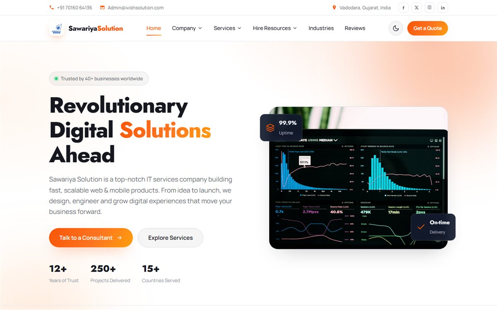
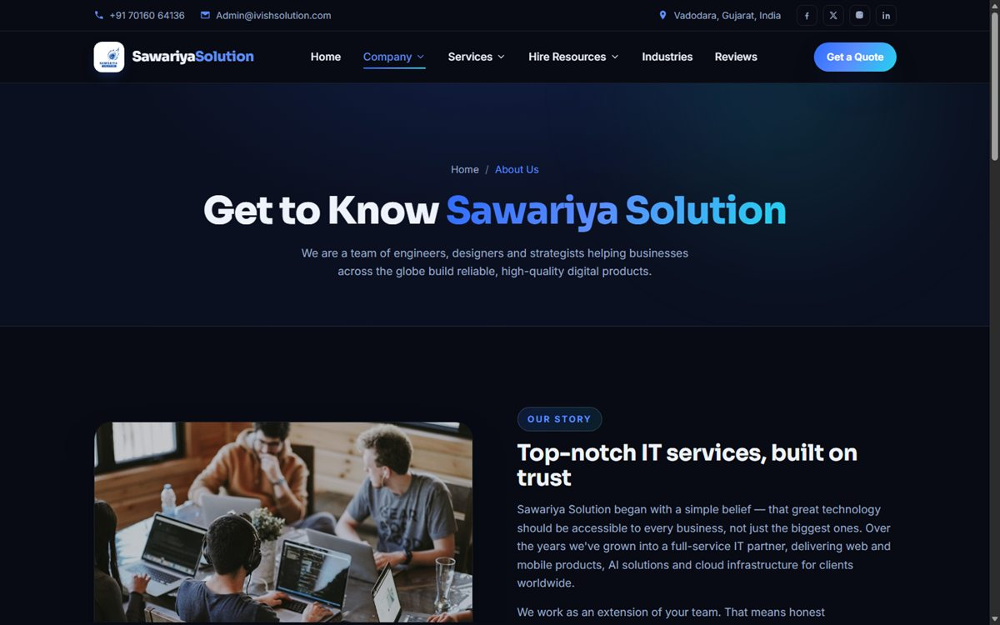
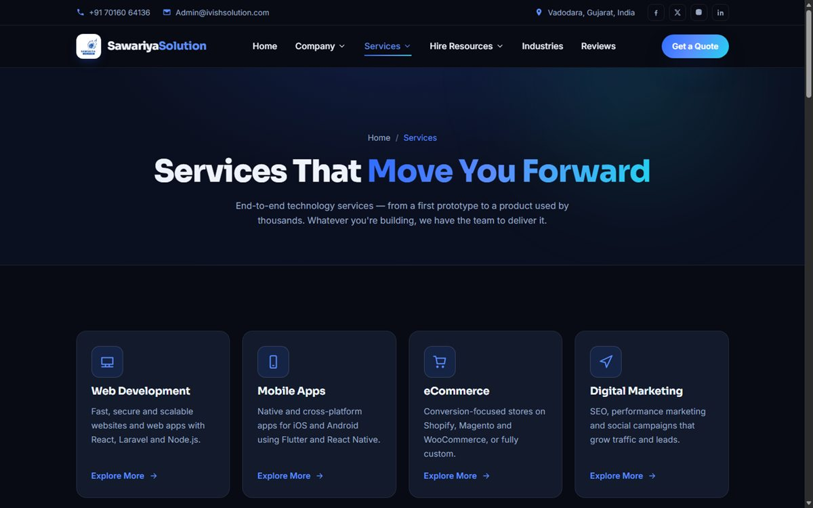
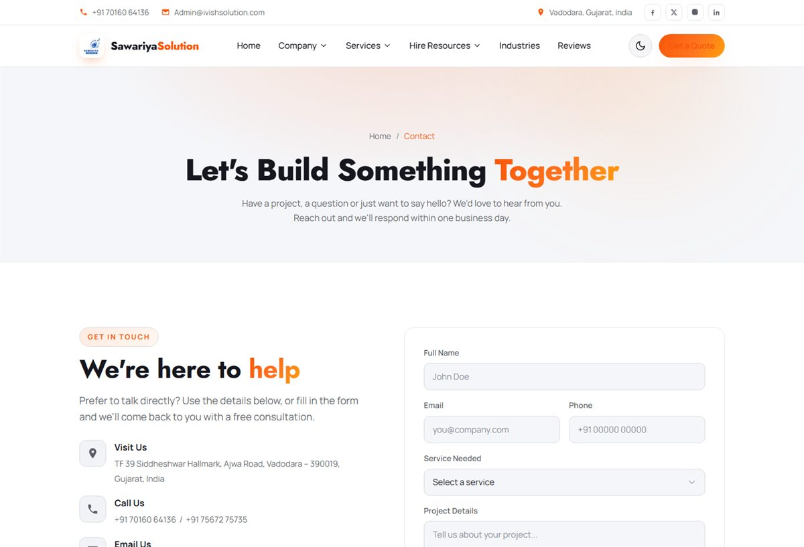
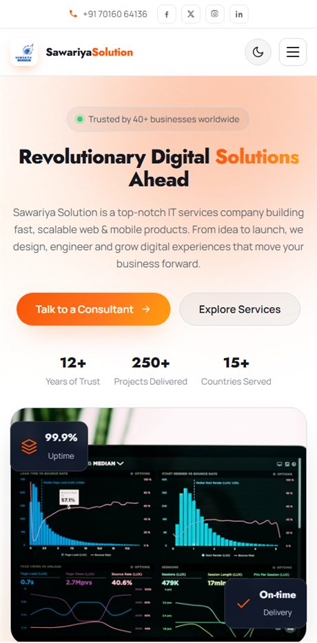

<h1 align="center">Sawariya Solution — Company Website</h1>

<p align="center">
  A responsive, multi-page website for <strong>Sawariya Solution</strong>,
  an IT services company offering web, mobile, eCommerce, AI/ML, blockchain and cloud development.
  <br/>A student project from my internship at Sawariya Solution (2026).
</p>

<p align="center">
  <a href="https://anime123450.github.io/sawariya-solution-website/">
    
  </a>
</p>

<p align="center">
  
  
  
  
</p>

> **🔗 Live site:** https://anime123450.github.io/sawariya-solution-website/

---

## 📸 Preview



<table>
  <tr>
    <td width="50%"><br/><sub><b>About</b></sub></td>
    <td width="50%"><br/><sub><b>Services</b></sub></td>
  </tr>
  <tr>
    <td width="50%"><br/><sub><b>Contact</b></sub></td>
    <td width="50%" align="center"><br/><sub><b>Mobile view</b></sub></td>
  </tr>
</table>

---

## 📖 Overview

This is a multi-page marketing website for Sawariya Solution. It is meant to be
responsive and to work on screen sizes from large desktops down to small phones.

It is built entirely with **HTML5, CSS3 and vanilla JavaScript** — no frameworks,
no libraries and no build step. Everything (fonts, images, icons) is self-hosted,
so the site does not depend on a CDN.

---

## ✨ Features

**Design & UI**
- Clean light theme (default) with a one-click **dark mode** toggle that remembers your choice
- Consistent design system built around the brand's signature orange accent
- Custom typography using the Jost & Manrope typefaces (self-hosted)
- Inline SVG icons — no icon library
- Smooth hover effects, micro-interactions and scroll-reveal animations

**Layout & Components**
- Sticky header with hover **mega-menus** (turns into an accordion drawer on mobile)
- Animated statistic counters and floating info cards
- Auto-playing, **swipeable** testimonials slider
- Two infinite marquees (technologies + services)
- Alternating feature sections, FAQ accordion and an interactive location map

**Functionality**
- Working enquiry form with live validation and a success message
- Responsive across desktop, laptop, tablet and mobile
- Back-to-top button, smooth scrolling and active navigation states

**Quality**
- SEO meta tags + Open Graph tags on every page
- Markup with `aria` labels and keyboard-friendly navigation
- `prefers-reduced-motion` support for users who prefer less animation
- Commented code

---

## 🗂️ Pages

| Page | File | What's inside |
|------|------|---------------|
| **Home** | `index.html` | Hero, about, services, industries, testimonials, process, tech stack, contact |
| **About** | `about.html` | Company story, key stats, mission & values, why choose us |
| **Services** | `services.html` | Full service list, detailed sections, work process, FAQ |
| **Contact** | `contact.html` | Contact details, enquiry form and a location map |

---

## 🛠️ Tech Stack

- **HTML5** — semantic markup
- **CSS3** — Grid, Flexbox, custom properties, `clamp()` fluid sizing, media queries
- **JavaScript (ES6+)** — vanilla, no dependencies
- **Fonts** — Jost & Manrope (self-hosted `.woff2`)
- **Icons** — inline SVG
- **Hosting** — GitHub Pages

---

## 📁 Project Structure

```
sawariya-solution-website/
├── index.html              # Home
├── about.html              # About Us
├── services.html           # Services
├── contact.html            # Contact
├── css/
│   └── style.css           # Full design system + responsive rules
├── js/
│   └── main.js             # Nav, counters, slider, reveal, form
├── assets/
│   ├── sawariya-logo.jpg
│   ├── fonts/              # Inter + Sora (self-hosted)
│   └── images/             # Photos + avatars
├── screenshots/            # README preview images
└── README.md
```

---

## 🚀 Getting Started

Clone the repository and open it — no installation required:

```bash
git clone https://github.com/Anime123450/sawariya-solution-website.git
cd sawariya-solution-website
```

Then just open `index.html` in your browser. For the best experience (clean URLs,
no browser file restrictions), run a small local server:

```bash
# Python 3
python -m http.server 8080
# then visit http://localhost:8080
```

---

## 🌐 Deployment

The site is deployed with **GitHub Pages** from the `main` branch. Any push to
`main` automatically rebuilds and updates the live site within a minute or two.

To deploy your own copy: push the code to a GitHub repository, then go to
**Settings → Pages**, choose the `main` branch and `/ (root)` folder, and save.

---

## 🎨 Customising

- **Text / content** — edit the `.html` files directly.
- **Colours** — change the CSS variables at the top of `css/style.css`
  (`--brand`, `--brand-2`, `--brand-3`, backgrounds).
- **Contact details & social links** — they appear in the top bar, contact section
  and footer of each page.
- **Photos** — replace the files in `assets/images/` (each is clearly named).
- **Connect the form to a backend** — replace the mock handler in `js/main.js`
  (`#contactForm`) with a real `fetch()` request to your endpoint.

---

## 📌 Roadmap

- [ ] Portfolio / Case Studies page
- [ ] Blog section
- [ ] Connect the enquiry form to a live inbox / CRM
- [ ] Custom domain

---

## 👤 Author

**Animesh Sharma**
GitHub: [@Anime123450](https://github.com/Anime123450)

---

<p align="center"><sub>© 2026 Sawariya Solution. All rights reserved.</sub></p>
